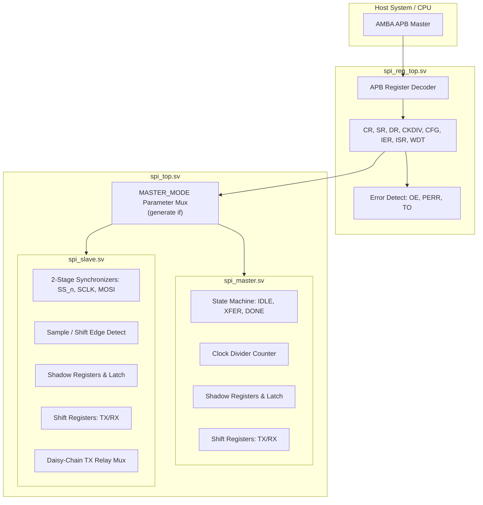

# Synthesizable 4-Wire SPI Controller IP (SystemVerilog)

A high-performance, fully synthesizable 4-wire Serial Peripheral Interface (SPI) IP core written in SystemVerilog (IEEE 1800-2012). Supports compile-time Master/Slave selection, multi-drop bus topologies, point-to-point daisy-chain cascading, and a zero-wait-state AMBA APB memory-mapped register interface.

Verified across Icarus Verilog and Verilator with >3,000 automated checks and 99.6%+ line/toggle code coverage.

---

## Architecture & Features



### Key Technical Capabilities

- **All 4 Standard SPI Modes**:
  - Mode 0: `CPOL = 0`, `CPHA = 0` (Idle low, sample leading rising edge)
  - Mode 1: `CPOL = 0`, `CPHA = 1` (Idle low, sample trailing falling edge)
  - Mode 2: `CPOL = 1`, `CPHA = 0` (Idle high, sample leading falling edge)
  - Mode 3: `CPOL = 1`, `CPHA = 1` (Idle high, sample trailing rising edge)
- **Runtime Bit Ordering & Dynamic Word Length**:
  - Selectable MSB-First or LSB-First bit transmission at runtime.
  - Parameterized maximum word width (`DATA_WIDTH`, verified 1 to 32 bits) with dynamic runtime word-length scaling (`cfg_data_width` / `SPI_CFG.DATA_BITS`).
  - Strict zero-extension: untransferred upper bits are cleanly masked and cleared.
- **Glitch-Free Mid-Transfer Reconfiguration**:
  - Dual-tier configuration architecture: shadow registers capture host updates immediately, while internal active registers latch mode and width only upon transfer initiation (`frame_start` or `ST_IDLE -> ST_XFER`).
  - Active in-flight words remain protected against mode/clock/width changes; updates seamlessly apply upon the next transfer.
- **Robust Clock Domain Crossing (CDC)**:
  - 2-stage flip-flop synchronizers on external inputs (`ss_n`, `sclk`, `mosi`) in slave mode.
  - Glitch-free synchronous edge detectors for arbitrary master-slave clock ratios.
- **Multi-Slave & Daisy-Chain Bus Topologies**:
  - **Multi-Drop Bus**: Slave `miso` output is tri-stated via raw `~ss_n` gate (`miso_oe`), preventing contention (`'X'`) across shared bus lines.
  - **Daisy-Chain Cascading**: Automatic `past_first_word` relay multiplexer taps the tail bit of `rx_shift` to forward incoming MOSI bits as an exact $N$-bit shift delay line.
- **AMBA APB Memory-Mapped Wrapper (`spi_reg_top.sv`)**:
  - Standard AMBA APB (v2/v3 2-phase SETUP/ACCESS) slave with zero wait states (`PREADY = 1'b1`).
  - Hardware RX overrun detection (`OE`), protocol error detection (`PERR`) with bus-level `PSLVERR`, and programmable 32-bit watchdog timer (`TO`).

---

## Directory Structure

```
spi_cl/
├── rtl/                          # Synthesizable SystemVerilog RTL
│   ├── spi_top.sv                # Compile-time Master/Slave top wrapper
│   ├── spi_master.sv             # Synthesizable SPI Master core
│   ├── spi_slave.sv              # Synthesizable SPI Slave core (CDC & daisy-chain)
│   └── spi_reg_top.sv            # AMBA APB register interface wrapper
├── tb/                           # Self-checking SystemVerilog testbenches
│   ├── tb_spi_loopback.sv        # Master-slave loopback, mode sweeps & glitch tests
│   ├── tb_spi_multi_slave.sv     # Multi-drop shared bus (1 master, N slaves)
│   ├── tb_spi_reg_top.sv         # APB CPU host register interface & error tests
│   └── tb_spi_daisy_chain.sv     # Cascaded daisy-chained slaves testbench
├── sim/                          # Simulation make targets
│   └── Makefile                  # Targets for iverilog, verilator, sweeps, coverage
├── docs/                         # Detailed architectural specifications
│   └── README.md                 # Deep-dive design & implementation notes
└── waves/                        # VCD trace output directory
```

---

## Memory-Mapped Register Map (`spi_reg_top.sv`)

Byte addresses, word-aligned (32-bit):

| Offset | Register | Access | Reset | Description |
| :---: | :---: | :---: | :---: | :--- |
| **`0x00`** | `SPI_CR` | R/W | `0x00000000` | Control: Bit 0 = `START` (self-clearing pulse), Bit 1 = `SOFT_RESET` (self-clearing pulse) |
| **`0x04`** | `SPI_SR` | R | `0x00000004` | Status: [0] `BUSY`, [1] `DONE`, [2] `TX_READY`, [3] `RX_VALID`, [4] `RX_BUSY`, [5] `ERR` |
| **`0x08`** | `SPI_DR` | R/W | `0x00000000` | Data Register: TX preload write, RX read (reading clears `DONE`/`RX_VALID`) |
| **`0x0C`** | `SPI_CKDIV`| R/W | `0x00000000` | Clock divider: $T_{sclk} = 2 \cdot (\text{CKDIV} + 1) \cdot T_{clk}$ |
| **`0x10`** | `SPI_CFG` | R/W | `0x00000000` | Config: [1:0] `MODE` (`{CPOL, CPHA}`), [2] `BIT_ORDER`, [8:3] `DATA_BITS` |
| **`0x14`** | `SPI_IER` | R/W | `0x00000000` | Interrupt Enable Register |
| **`0x18`** | `SPI_ISR` | R/W1C| `0x00000000` | Interrupt Status (W1C): [0] `DONE`, [1] `TX_READY`, [2] `OE`, [3] `PERR`, [4] `TO` |
| **`0x1C`** | `SPI_WDT` | R/W | `0x00000000` | Watchdog timeout threshold (cycles, 0 = disabled) |

### Error Detection & Diagnostics

1. **RX Overrun (`OE`)**: Raised when `SPI_CR.START` is written before previous RX data in `SPI_DR` has been collected (`done_latch == 1`).
2. **Protocol Error (`PERR`) & `PSLVERR`**: Raised and triggers `PSLVERR` during APB ACCESS phase upon:
   - Access to unmapped address.
   - Writing to read-only `SPI_SR`.
   - Setting `SPI_CR.START` while busy.
   - Writing `DATA_BITS > DATA_WIDTH` in `SPI_CFG`.
3. **Watchdog Timeout (`TO`)**: Monitored strictly during `busy == 1`. If transfer exceeds `SPI_WDT` cycles, raises diagnostic `TO` interrupt without aborting transfer.

---

## Verification & Test Results

The IP is verified with 4 automated self-checking testbenches:

| Testbench | Checks | Status | Scope & Scenarios Covered |
| :--- | :---: | :---: | :--- |
| **`tb_spi_loopback.sv`** | 927 | **PASS** | Exhaustive 4 modes × 2 bit orders × 2 divisors × 27 data patterns. Master-slave CDC (100MHz vs 250MHz). Mid-transfer config glitches, `cfg_wr_en` gate checks, mid-transfer async reset. |
| **`tb_spi_multi_slave.sv`** | 120 | **PASS** | 1 Master + 3 Slaves on shared MISO/MOSI/SCLK bus. Chip-select arbitration, zero contention (`'X'`), per-slave unique signature verification. |
| **`tb_spi_reg_top.sv`** | 1,679 | **PASS** | Full APB bus protocol, register sweeps, interrupt masking, W1C checks, soft reset, error injection (PERR, OE), watchdog timeout. |
| **`tb_spi_daisy_chain.sv`** | 360 | **PASS** | Virtual bit-banged master + 3 cascaded slaves. Multi-word cascading shift register, reverse-order signature extraction. |
| **`width-sweep`** | 18 runs | **PASS** | Full parameterization sweep across widths `{1, 2, 3, 4, 5, 8, 12, 16, 32}` on both Icarus Verilog and Verilator. |

### Code Coverage

Coverage instrumented with Verilator line and toggle coverage:
- **Core RTL (`spi_master.sv`, `spi_slave.sv`, `spi_top.sv`)**: **99.6%** (248/249 points covered; the single miss is an intentionally unreachable defensive `default: state <= ST_IDLE;` in a 3-state 2-bit enum).
- **APB Interface (`spi_reg_top.sv`)**: **100.0%** (132/132 points covered).

---

## Build & Simulation Instructions

### Prerequisites
- **Icarus Verilog** (`iverilog` v10.0+ with `-g2012`) & `vvp`
- **Verilator** (v5.020+ clean build with `-Wall`)
- **GTKWave** (optional, for viewing VCD waveform dumps)

### Running Simulations

All simulations are executed from the `sim/` directory:

```bash
cd sim

# Compile and run loopback testbench under Icarus Verilog
make iverilog

# Compile and run loopback testbench under Verilator
make verilator

# Run multi-drop bus testbench (1 master, 3 slaves)
make multi-slave

# Run APB register-interface testbench
make reg-if

# Run daisy-chained slaves testbench
make daisy-chain

# Run full width-parameter sweep across 9 word sizes
make width-sweep

# Run coverage-instrumented builds
make coverage
make coverage-reg-if

# Clean all build artifacts
make clean
```

### Viewing Waveforms

Waveforms are generated automatically in `waves/`:

```bash
gtkwave waves/iverilog.vcd
gtkwave waves/verilator.vcd
gtkwave waves/verilator_reg_top.vcd
gtkwave waves/verilator_multi_slave.vcd
gtkwave waves/verilator_daisy_chain.vcd
```

---

## License

This project is licensed under the MIT License.
